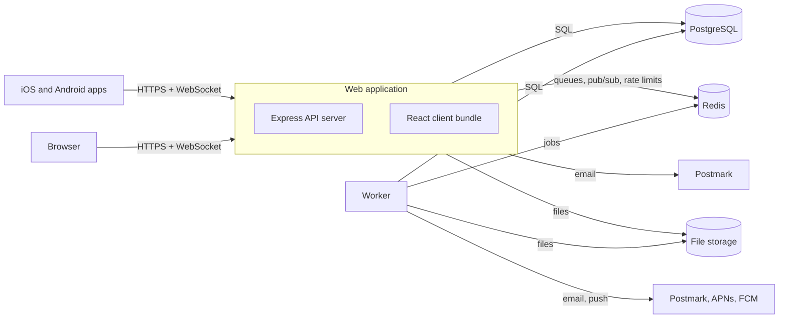

# System Overview

The pieces of the platform, what each is responsible for, and how they talk
to each other.

## The Pieces

| Piece | Code | Responsible for |
| ----- | ---- | --------------- |
| **Web application** | `web-application/` | The REST API (`/api/0.0.0`), the WebSocket (`/socket`), and every page: it serves the client bundle and renders each page's metadata into it. Stateless: sessions live in PostgreSQL, and everything shared between instances goes through Redis. See [Server](server.md). |
| **Client** | `web-application/client/` | The React and Redux app that runs in browsers and, wrapped by Capacitor, as the iOS and Android apps. Talks only to the API and WebSocket. See [Client](client.md) and [Mobile](mobile.md). |
| **Worker** | `worker/` | Long-running work taken off the request: resizing images, processing video, sending notifications, maintaining mutual friends. See [Worker](worker.md). |
| **Backend package** | `packages/backend/` | What the web application and worker share: `Core`, DAOs, services, drivers and migrations. See [Backend](backend.md). |
| **Shared package** | `packages/shared/` | What the client and server share: schemas, validation, permission rules, helpers. See [Shared](shared.md). |
| **PostgreSQL** | `database/` | All persistent data, and sessions. PostGIS and `pg_trgm` extensions. See [Database](../database/README.md). |
| **Redis** | | Bull job queues, the pub/sub channel that carries events between instances, and rate limit counters. |
| **File storage** | | Uploaded images and videos and their processed variants, plus News posts and a few assets. S3 on staging and production, a local folder in development. |

## Outside Services

| Service | Used for | Locally |
| ------- | -------- | ------- |
| Postmark | Sending email. | Logged instead (`log` driver). |
| Apple Push Notification service, Firebase Cloud Messaging | Push notifications to the iOS and Android apps. | Logged instead. |
| Amazon S3 | File storage. | A local folder. |
| AWS Systems Manager Parameter Store | Configuration values and secrets on staging and production. | Environment variables. |
| Sentry | Client error reporting, in production only. | Off. |

## How They Talk

- **Client to server:** JSON over HTTPS to the API. Every request names its
  platform in `X-Communities-Platform`, and every request but a `GET`
  carries the session's CSRF token. Browsers carry the session in a cookie;
  the apps carry it in a header (see [Server](server.md#sessions)).
- **Server to client, unprompted:** events over the WebSocket, such as job
  progress and new notifications. Code anywhere calls
  `core.events.trigger()`, which publishes on the Redis channel
  `communities:events`; every web instance receives it and sends it to the
  connections it holds that have subscribed. Events are best effort: a
  client that's disconnected misses them, so anything it can't miss is
  also fetched through the API.
- **Web application to worker:** jobs on Bull queues in Redis, one queue
  per kind of job. Job progress comes back to the client as events. See
  [Worker](worker.md).
- **Between instances:** there can be several web application and worker
  instances. They share PostgreSQL and Redis, and nothing else.

## Deployment

Staging and production run the web application and worker as container
images built by the Release workflow, with one worker deployment per
queue. The cloud infrastructure they run on, and deploying to it, are
handled in the infrastructure repository. See
[Environments](environments.md) and [Releases](../releases.md).
