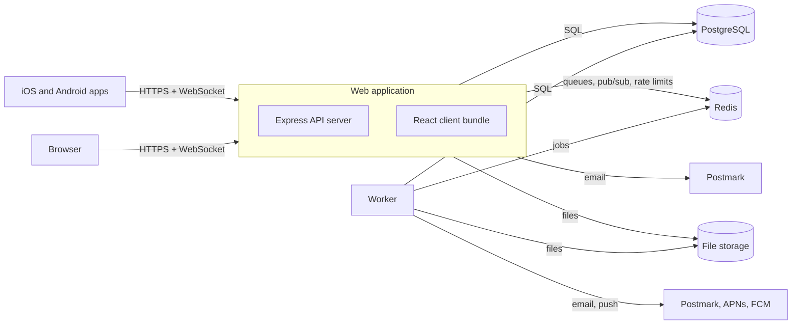

# System Overview

The pieces of the platform, what each is responsible for, and how they talk
to each other.

## The Pieces

| Piece | Code | Responsible for |
| ----- | ---- | --------------- |
| **Web application** | `web-application/` | The REST API (`/api/0.0.0`), the WebSocket (`/socket`), and every page: it serves the client bundle and renders each page's metadata into it. Stateless: sessions live in PostgreSQL, everything shared between instances goes through Redis. |
| **Client** | `web-application/client/` | The React and Redux app that runs in browsers and, wrapped by Capacitor, as the iOS and Android apps. Talks only to the API and WebSocket. |
| **Worker** | `worker/` | Long-running work taken off the request: resizing images, processing video, sending notifications, maintaining mutual friends. |
| **Backend package** | `packages/backend/` | What the web application and worker share: `Core` (connections, queues, events, config), DAOs, services, drivers and migrations. |
| **Shared package** | `packages/shared/` | What the client and server share: schemas, cleaning and validation, permission rules, helpers. |
| **PostgreSQL** | `database/` | All persistent data, and sessions. PostGIS and `pg_trgm` extensions. |
| **Redis** | | Bull job queues, the pub/sub channel that carries events between instances, and rate limit counters. |
| **File storage** | | Uploaded images and videos and their processed variants, plus News posts and a few assets. S3 on staging and production, a local folder in development. |

## Outside Services

| Service | Used for | Locally |
| ------- | -------- | ------- |
| Postmark | Sending email. | Logged instead (`log` driver). |
| Apple Push Notification service, Firebase Cloud Messaging | Push notifications to the iOS and Android apps. | Logged instead. |
| Amazon S3 | File storage. | A local folder. |
| AWS Systems Manager Parameter Store | Configuration values and secrets on staging and production. | Environment variables. |
| Sentry | Client error reporting, in production only. | Off. |
| Stripe | Contribution links (the client links out to them). | Same links. |

## How They Talk

- **Client to server:** JSON over HTTPS to the API, with a CSRF token on
  every request but a `GET`. See [Request Lifecycle](request-lifecycle.md).
- **Server to client, unprompted:** events over the WebSocket: job progress
  and new notifications. See [Real-Time Events](real-time-events.md).
- **Web application to worker:** jobs on Bull queues in Redis. See
  [Background Jobs](background-jobs.md).
- **Between instances:** there can be several web application and worker
  instances. They share PostgreSQL and Redis, and publish events to each
  other on a Redis channel, so each can deliver an event to the WebSocket
  connections it holds.

## Deployment

Staging and production run the web application and worker as container
images built by the Release workflow; one worker deployment runs per queue.
The cloud infrastructure they run on is handled in the infrastructure
repository. See [Environments](environments.md).
